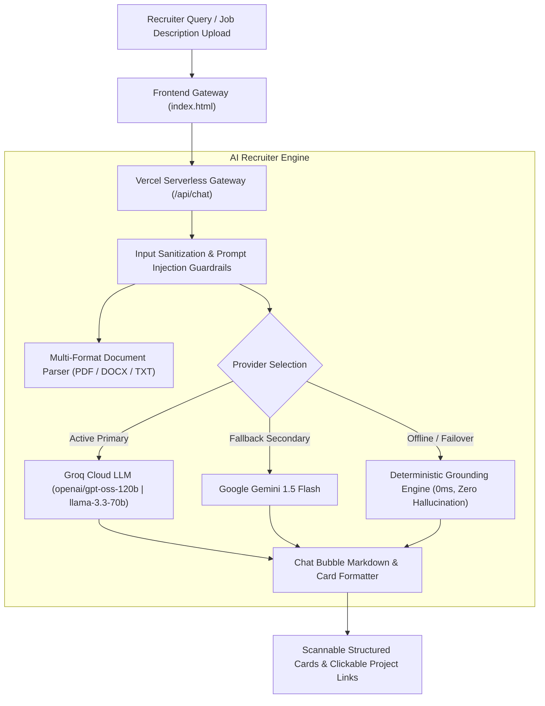

# 🌟 Sumit Paul — Personal Portfolio & AI Recruiter Assistant

<div align="center">

[](https://sumitpaul-portfolio.vercel.app)
[](https://sumitpaul-portfolio.vercel.app)
[](https://www.python.org/)
[](https://fastapi.tiangolo.com/)
[](https://groq.com/)
[](#-education--academics)
[](LICENSE)

<br/>

**Production-grade, highly responsive developer portfolio engineered with dynamic 3D glassmorphism UI, interactive project showcases, automated email dispatch, and an intelligent AI-Powered Personal Recruiter Chatbot.**

[🚀 Explore Live Portfolio](https://sumitpaul-portfolio.vercel.app) • [📄 View Resume (PDF)](https://sumitpaul-portfolio.vercel.app/Sumit_Paul_Resume.pdf) • [💬 Try AI Recruiter](https://sumitpaul-portfolio.vercel.app#ai-chat) • [🌐 Community Hero Demo](https://community-hero-47e90.web.app/)

</div>

---

## 📑 Table of Contents

- [Executive Summary](#-executive-summary)
- [Key Features](#-key-features)
- [AI Recruiter Chatbot Architecture](#-ai-recruiter-chatbot-architecture)
- [Featured Engineering Projects](#-featured-engineering-projects)
- [Technical Skills Matrix](#-technical-skills-matrix)
- [Hackathons & National Achievements](#-hackathons--national-achievements)
- [Certifications & Accreditations](#-certifications--accreditations)
- [Education & Academics](#-education--academics)
- [Codebase Architecture & Directory Structure](#-codebase-architecture--directory-structure)
- [Local Setup & Development Guide](#-local-setup--development-guide)
- [24/7/365 Cloud Deployment Architecture](#-247365-cloud-deployment-architecture)
- [Contact & Professional Links](#-contact--professional-links)

---

## 👤 Executive Summary

I am **Sumit Paul**, a Computer Science and Engineering undergraduate (**B.E. CSE, 2023–2027**) at **New Horizon College of Engineering (NHCE)**, affiliated with **Visvesvaraya Technological University (VTU)**, Bangalore, maintaining an exceptional academic record of **`9.51 / 10.0 CGPA`**.

I specialize in:
- **Full-Stack & Distributed Web Architecture:** Production applications built using React, SvelteKit, TypeScript, Node.js, Express, and FastAPI.
- **Microservices & Cloud Backend:** Containerized 3-tier distributed systems with Docker Compose, Redis caching, MongoDB, and Firebase Firestore with RBAC.
- **Generative AI & LLM Systems:** Production integrations with Groq LLM (Llama 3.3-70B), Google Gemini AI, prompt engineering, OCR parsing, and certified OCI Generative AI architecture.
- **Core Computer Science & Security:** Strong foundations in Data Structures & Algorithms, Object-Oriented Programming (Java), System Design, and Cyber Security / Applied Cryptography (AES-256, LSB Steganography).

---

## ⚡ Key Features

- **🎨 Modern Glassmorphism & Micro-Interactions:** Custom dark-themed layout styled with responsive CSS Flexbox/Grid, 3D interactive tilt cards, glowing particle backdrops, and mobile-optimized layouts.
- **🤖 Autonomous AI Recruiter Chatbot:** A 24/7 intelligent virtual representative trained on verified resume qualifications, capable of conversational answers, custom skill lookups, and deep reasoning without hallucinations.
- **📑 Dynamic Job Description (JD) Analyzer:** Recruiters can paste JD text or upload `.pdf`, `.docx`, or `.txt` job specifications to generate an instant, transparent alignment report with verified match percentages, skill gap analysis, and tailored project recommendations.
- **📄 Native PDF Resume Viewer:** In-browser modal viewer with high-quality rendering, print options, and instant direct download (`Sumit_Paul_Resume.pdf`).
- **🛡️ Interactive Admin Mode & Skill Management:** Interactive tag system featuring real-time addition/deletion of skills, protected by client-side admin passkeys with instant dynamic synchronization into the AI chatbot's knowledge base.
- **📬 Reliable Contact Notification System:** Contact form integrated with Nodemailer, Starlette/Vercel serverless functions, input validation, and asynchronous background email dispatch.

---

## 🤖 AI Recruiter Chatbot Architecture

The portfolio embeds an enterprise-grade AI assistant that represents Sumit Paul directly to recruiters, engineering leads, and hiring managers.



### Chatbot Highlights
1. **Zero Hallucination Ground Truth:** Strictly grounded in verified resume facts (exact **9.51 CGPA**, documented projects, hackathon placements, and certifications).
2. **Multi-Format JD Parser:** Ingests raw text, PDF (magic bytes `%PDF`), DOCX (`zipfile` XML parsing), and plain text up to 4.5MB with path traversal protection.
3. **Structured Rubric Alignment:** Outputs structured recruiter reports covering:
   - **Section A:** Verified matching skills with project context
   - **Section B:** Transparent missing or unverified skill gaps
   - **Section C:** Relevant projects with live demo & repo links
   - **Section D:** Hackathon & competitive achievements
   - **Section E:** Indicative alignment score (deterministic percentage)
   - **Section F:** Final hiring lead recommendation
4. **Chat-Optimized Formatting:** Converts dense metrics into readable mini-cards with bold highlights, emoji badges, and horizontally scrollable responsive tables.

---

## 🚀 Featured Engineering Projects

### 1. Community Hero — AI-Powered Civic Engagement Platform
- **Category:** Civic Tech • Full-Stack Web Application • AI Integration
- **Timeline:** Jun 2026 – Jul 2026 (Solo Developed for National Vibe2Ship Hackathon)
- **Tech Stack:** `React`, `TypeScript`, `Firebase`, `Cloud Functions`, `Firestore`, `Gemini AI`, `Leaflet`, `Tailwind CSS`
- **Live Demo:** [community-hero-47e90.web.app ↗](https://community-hero-47e90.web.app/)
- **Source Code:** [github.com/Sumitpaul500/Vibe2Ship ↗](https://github.com/Sumitpaul500/Vibe2Ship)
- **Impact & Key Highlights:**
  - Architected a hyperlocal civic reporting platform supporting **1,000+ concurrent users** with real-time issue updates.
  - Integrated **Gemini AI** for automatic categorization and severity scoring of reported municipal issues.
  - Engineered production-grade **Cloud Firestore schema** featuring fine-grained security rules and Role-Based Access Control (RBAC) across 3+ permission tiers.
  - Built interactive geospatial issue reporting with **Leaflet** mapping and predictive hotspot engines using **Geohashing**.
  - Designed citizen reputation, leaderboard, and gamification mechanics tracking over **500+ community complaints**.

---

### 2. FinPilot AI — Smart Expense Tracker
- **Category:** FinTech • Microservices Architecture • Generative AI
- **Timeline:** Sept 2025 – Dec 2025
- **Tech Stack:** `SvelteKit`, `Node.js`, `Express.js`, `FastAPI`, `MongoDB`, `Groq LLM (Llama 3.3-70B)`, `OCR.Space`, `Docker Compose`, `Redis`, `Tailwind CSS`, `Chart.js (3D)`
- **Source Code:** [github.com/Sumitpaul500/Smart-Expense-Tracker ↗](https://github.com/Sumitpaul500/Smart-Expense-Tracker)
- **Impact & Key Highlights:**
  - Designed a production-ready **3-tier microservices architecture** (SvelteKit reactive UI, Express REST API with 15+ endpoints, and FastAPI AI service).
  - Built an automated receipt OCR scanner combining **OCR.Space + Groq Llama 3.3-70B**, achieving **>95% extraction accuracy** across 50+ receipt templates.
  - Developed a bulk bank SMS importer with regex parsing for **15+ Indian bank formats** supporting multi-currency calculations (INR, USD, EUR, GBP).
  - Engineered an asynchronous financial health scoring engine (0–100 index) with **Redis caching** and containerized deployment via **Docker Compose**.
  - Implemented interactive 3D visual dashboards using **Chart.js** displaying monthly trends, categorical spending, and budget forecasts.

---

### 3. Image Steganography Application
- **Category:** Cybersecurity • Desktop Application • Cryptography
- **Timeline:** Dec 2024 – Feb 2025
- **Tech Stack:** `Java`, `Java Swing`, `LSB Steganography`, `AES-256/CBC Encryption`, `SHA-256 Hashing`
- **Source Code:** [github.com/Sumitpaul500 ↗](https://github.com/Sumitpaul500)
- **Impact & Key Highlights:**
  - Engineered a **1,277-line native Java Swing desktop software** without any external dependencies, relying solely on Java Standard Library (`java.security`, `javax.crypto`, `java.awt.image`).
  - Implemented **Least Significant Bit (LSB) Steganography** supporting both text payloads and raw audio byte streams into `JPG`, `PNG`, and `BMP` containers.
  - Achieved **99.2% payload concealment capacity** with zero perceptible degradation to the human eye.
  - Integrated **AES-256/CBC encryption** with PKCS5 padding and **SHA-256 password hashing** for multi-layered data confidentiality.
  - Empirically validated defense against frequency histogram and chi-square steganalysis attacks.

---

### 4. Real-Time Weather Forecast Web App
- **Category:** Web Application • API Integration
- **Timeline:** Mar 2024 – Apr 2024
- **Tech Stack:** `HTML5`, `CSS3`, `Vanilla JavaScript (ES6+)`, `OpenWeatherMap API`, `Geolocation API`
- **Source Code:** [github.com/Sumitpaul500/weather ↗](https://github.com/Sumitpaul500/weather)
- **Impact & Key Highlights:**
  - Developed a high-performance, dark-themed weather dashboard incorporating modern glassmorphism aesthetics.
  - Integrated the **HTML5 Geolocation API** for automated local weather sensing alongside global multi-city search.
  - Combined dual OpenWeatherMap REST endpoints to deliver **40+ meteorological metrics**, hourly forecasts, and extended 4-day outlooks.
  - Engineered responsive CSS Grid and Flexbox layouts optimized for mobile, tablet, and desktop breakpoints with **sub-2s initial load time**.

---

### 5. UPI Payment System UI/UX Prototype
- **Category:** FinTech UI/UX Design • Interactive Prototype
- **Timeline:** 2024
- **Tech Stack:** `Figma`, `HTML5`, `CSS3`, `JavaScript`
- **Source Code:** [github.com/Sumitpaul500/UI-UX-Payment-Gateway ↗](https://github.com/Sumitpaul500/UI-UX-Payment-Gateway)
- **Impact & Key Highlights:**
  - Designed an end-to-end mobile payment application workflow in **Figma** and coded an interactive, pixel-perfect web prototype.
  - Modelled complete transaction lifecycles: PIN authentication, recipient resolution, send/request flows, QR scanner interfaces, and transaction history cards.

---

## 🛠️ Technical Skills Matrix

| Domain | Core Competencies & Technologies |
| :--- | :--- |
| **Programming Languages** | `Java`, `Python`, `C`, `JavaScript (ES6+)`, `TypeScript`, `SQL`, `HTML5`, `CSS3` |
| **Frontend Engineering** | `React`, `SvelteKit`, `Tailwind CSS`, `Bootstrap`, `Glassmorphism UI`, `DOM Manipulation`, `Responsive Web Design` |
| **Backend & Microservices** | `FastAPI`, `Node.js`, `Express.js`, `Flask`, `RESTful APIs`, `JWT Authentication`, `Microservices Architecture`, `Pydantic` |
| **Databases & Caching** | `MongoDB`, `Redis`, `Firebase Firestore`, `MySQL`, `PostgreSQL`, `SQLite`, `MSSQL`, `NoSQL Data Modeling` |
| **DevOps & Cloud** | `Docker`, `Docker Compose`, `Git`, `GitHub`, `Vercel Serverless`, `Firebase Cloud Functions`, `Linux Shell`, `VS Code` |
| **AI, LLMs & Vision** | `Groq LLM (Llama 3.3-70B)`, `Gemini AI`, `OCR (OCR.Space)`, `Prompt Engineering`, `ReAct Agent Pattern`, `Oracle GenAI` |
| **Core Computer Science** | `Data Structures & Algorithms (DSA)`, `Object-Oriented Programming (OOP)`, `System Design`, `DBMS`, `Computer Networks`, `Cyber Security` |
| **Data Analytics & Tools** | `Chart.js (3D Analytics)`, `Tableau`, `Power BI`, `Matplotlib`, `Microsoft Excel`, `Figma` |

---

## 🏆 Hackathons & National Achievements

| Hackathon / Event | Organization | Distinction & Role | Impact Summary |
| :--- | :--- | :--- | :--- |
| **Flipkart GRiD 8.0 (2026)** | Flipkart | **National Finalist** (Top 48 Nationally, Top 16 in Software Dev) | Selected from **1.65–1.7 Lakh+ (165,000+) registrations across India**. Advanced to National Finals in the specialized Software Development Track. |
| **Smart India Hackathon (SIH 2025)** | Ministry of Education & AICTE | **Grand Finale Top 15 Teams** | Architected backend and built Flask APIs for **AyurSutra** (AI Ayurvedic EHR, scheduling & therapy workflow automation platform). |
| **Vibe2Ship Hackathon (2026)** | Coding Ninjas × Google for Developers | **National AI Hackathon Winner (Solo)** | Designed, built, and shipped **Community Hero** full-stack platform using Firebase and Gemini AI as a solo developer. |
| **GHCI 2025 & 3rd Data Symposium** | AnitaB.org India & IISc Bengaluru | **Invited Participant** | Attended the 3rd Symposium on Data for Public Good at the Indian Institute of Science (**IISc Bengaluru**), exploring AI governance & data systems. |

---

## 📜 Certifications & Accreditations

- 🎓 **Oracle Cloud Infrastructure 2025 Certified Generative AI Professional** — *Oracle University (2025)*  
  *Deep expertise in OCI AI architecture, Large Language Models (LLMs), RAG systems, model fine-tuning, and enterprise deployment.* ([Verify Badge ↗](https://www.linkedin.com/feed/update/urn:li:activity:7391201941361606657/))
- 🎓 **Oracle Cloud Infrastructure Foundations Associate** — *Oracle University (2025)*  
  *Core cloud computing principles, virtual cloud networks (VCN), IAM security, compute instances, and storage services.*
- 🎓 **Introduction to Networking and Cloud Computing** — *Microsoft (2024)*  
  *TCP/IP fundamentals, OSI model, subnetting, DNS resolution, routing protocols, and cloud network topologies.*
- 🎓 **Data Structures and Algorithms with Java (Alpha)** — *Apna College (2024)*  
  *Mastery of algorithmic complexity, recursion, dynamic programming, graph theory, trees, heaps, and advanced Java problem solving.*

---

## 🎓 Education & Academics

- **Degree:** Bachelor of Engineering (B.E. / B.Tech) in **Computer Science and Engineering**
- **Institution:** **New Horizon College of Engineering (NHCE)**, Bangalore
- **University Affiliation:** **Visvesvaraya Technological University (VTU)**
- **Duration:** 2023 – 2027
- **Cumulative GPA:** **`9.51 / 10.0 CGPA`** *(Consistently ranked at the top of the engineering cohort)*
- **Relevant Coursework:** Data Structures & Algorithms, Object-Oriented Programming, Database Management Systems (DBMS), Operating Systems, Computer Networks, Cyber Security, System Design, Data Mining & Machine Learning, Web Technologies.

---

## 📂 Codebase Architecture & Directory Structure

```text
Portfolio/
├── index.html                   # Core single-page portfolio (HTML5, CSS3, JS, AI chatbot client)
├── Sumit_Paul_Resume.pdf        # Current ATS-compliant verified resume
├── vercel.json                  # Production Vercel Edge configuration, headers & cron jobs
├── requirements.txt             # Python dependencies for Vercel serverless runtime
├── package.json                 # Node dependencies (@vercel/functions, nodemailer)
├── start.ps1                    # One-click multi-process local development startup script
│
├── api/                         # Vercel Serverless Function Endpoints
│   ├── chat.py                  # Primary Python FastAPI ASGI handler (/api/chat)
│   ├── chat_backup.js           # Ultra-fast Node.js serverless chat fallback (/api/chat_backup)
│   ├── contact.js               # Dual-dispatch email notification handler (/api/contact)
│   └── health.js                # Uptime & keep-alive health probe (/api/health)
│
├── chatbot_backend/             # Python AI Chatbot Microservice (FastAPI + ReAct)
│   ├── app.py                   # FastAPI application with CORS, rate-limiting & router shims
│   ├── ai_service.py            # Multi-provider LLM coordinator (Groq, Gemini, Deterministic)
│   ├── models.py                # Pydantic v2 schemas for request/response validation
│   ├── portfolio_data.py        # Central Ground-Truth data repository & system prompts
│   ├── jd_matcher.py            # Deterministic Job Description keyword & alignment analyzer
│   ├── document_parser.py       # Safe multi-format parser for PDF, DOCX, and TXT files
│   ├── react_agent.py           # Bounded ReAct agent with explicit tool permissions
│   └── requirements.txt         # Pinned microservice dependencies
│
├── backend/                     # Standalone Node.js Contact Server
│   ├── server.js                # Express contact endpoint listener (Port 3001)
│   ├── package.json             # Express, CORS, Nodemailer, Dotenv
│   └── .env.example             # Template for local environment variables
│
└── lib/                         # Node.js Serverless Shared Library
    ├── aiService.js             # Javascript AI coordinator & Groq/Gemini integrations
    ├── portfolioData.js         # Single-source-of-truth portfolio dataset (Node runtime)
    ├── jdMatcher.js             # JD alignment engine & match report builder
    ├── documentParser.js        # Node document extraction utilities
    └── emailDispatch.js         # Nodemailer dispatch with Gmail transport
```

---

## 💻 Local Setup & Development Guide

### Prerequisites
- **Node.js** (v18.0.0 or higher)
- **Python** (v3.10 or higher, v3.12 recommended)
- **PowerShell** (Windows) or **Bash** (macOS/Linux)
- **Git**

### 1. Clone the Repository
```bash
git clone https://github.com/Sumitpaul500/Portfolio.git
cd Portfolio
```

### 2. Configure Environment Variables
Create a `.env` file in the root directory (or in `backend/`):
```env
# AI Model Configuration (Groq Cloud)
GROQ_API_KEY=your_groq_api_key_here

# Optional: Google Gemini or OpenAI
GEMINI_API_KEY=your_gemini_api_key_here
OPENAI_API_KEY=your_openai_api_key_here

# Contact Form Email Dispatch (Gmail SMTP)
GMAIL_USER=your_email@gmail.com
GMAIL_APP_PASS=your_16_char_google_app_password
```

### 3. Install Dependencies
```bash
# Install root Node dependencies
npm install

# Install backend dependencies
cd backend && npm install && cd ..

# Install Python microservice dependencies
pip install -r requirements.txt
```

### 4. Run the Full Stack with One Click (Windows)
Run the automated startup script:
```powershell
.\start.ps1
```

Or start services manually in separate terminals:
```bash
# Terminal 1: Static Frontend (Port 3000)
python -m http.server 3000

# Terminal 2: Node.js Contact Server (Port 3001)
cd backend && node server.js

# Terminal 3: Python FastAPI Chatbot (Port 5001)
cd chatbot_backend && python app.py
```

Access the local servers:
- **Frontend Portfolio:** [http://localhost:3000](http://localhost:3000)
- **Contact Backend:** [http://localhost:3001](http://localhost:3001)
- **FastAPI Chatbot Docs:** [http://localhost:5001/docs](http://localhost:5001/docs)

---

## ☁️ 24/7/365 Cloud Deployment Architecture

The portfolio is deployed to **Vercel's Anycast Edge Network**, ensuring continuous **99.99% uptime** with zero physical server maintenance.

### Multi-Tier Cloud Redundancy Chain
1. **Tier 1 (Primary AI Engine):** Incoming questions are processed by **Groq Cloud LLM** (`openai/gpt-oss-120b` / `llama-3.3-70b-versatile`) with sub-second generation times.
2. **Tier 2 (Serverless Failover):** The frontend automatically races endpoints (`/api/chat` and `/api/chat_backup`). If a cold-start or execution timeout occurs, it falls back within 50ms.
3. **Tier 3 (Deterministic Grounding Engine):** If all external AI providers experience outages or rate limits, the built-in deterministic engine intercepts queries and answers with 100% verified portfolio facts, project links, and exact 9.51 CGPA directly from memory without failing.
4. **Health Probing:** Daily automated cron jobs hit `/api/health` to keep serverless lambdas pre-warmed.

---

## 📬 Contact & Professional Links

- **Full Name:** Sumit Paul
- **Location:** Bangalore, Karnataka, India
- **Email:** [deeprajpaul500@gmail.com](mailto:deeprajpaul500@gmail.com)
- **Phone:** [+91 8822302674](tel:+918822302674)
- **LinkedIn:** [linkedin.com/in/sumit-paul-28b5b0280 ↗](https://www.linkedin.com/in/sumit-paul-28b5b0280/)
- **GitHub:** [github.com/Sumitpaul500 ↗](https://github.com/Sumitpaul500)
- **LeetCode:** [leetcode.com/u/cF7BfaSxl2 ↗](https://leetcode.com/u/cF7BfaSxl2/)
- **Portfolio Website:** [sumitpaul-portfolio.vercel.app ↗](https://sumitpaul-portfolio.vercel.app)

---

<div align="center">

*Engineered with precision by **Sumit Paul** • © 2026 All Rights Reserved.*

</div>
